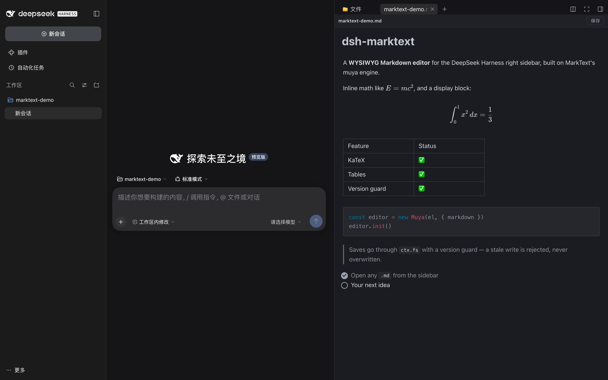

<p align="center">
  
</p>

<h1 align="center">dsh-marktext</h1>

<p align="center">
  <b>Write Markdown the way it will look.</b><br/>
  MarkText's editor engine, living in the DeepSeek Harness right sidebar.
</p>

<p align="center">
  <a href="https://www.npmjs.com/package/dsh-marktext"></a>
  <a href="https://www.npmjs.com/package/dsh-marktext"></a>
  <a href="https://github.com/Roland0511/dsh-marktext/stargazers"></a>
  <a href="https://opensource.org/licenses/MIT"></a>
  
  <a href="https://github.com/Roland0511/dsh-marktext/actions/workflows/publish.yml"></a>
</p>

<p align="center">
  <a href="README.md"><b>English</b></a> · <a href="README.zh.md">简体中文</a>
</p>



**Click a `.md` and it opens as the document it will become** — headings, tables, math, diagrams and images, all editable where they stand. Fix a sentence, delete a paragraph, or **select the part you want to talk about and quote it into the chat**. No split pane, no source-and-preview dance. `⌘S` saves through a version guard, so you never overwrite someone else's edit.

> MarkText is an Electron desktop app. This plugin doesn't ship its shell — it takes the editor core MarkText extracts ([`@muyajs/core`](https://www.npmjs.com/package/@muyajs/core) / muya, MIT) and adds only the DSH integration. Everything runs locally.

## Why it feels different

- **✍️ You edit the document, not the source.** Markdown markers stay hidden; headings, lists, tables and quotes are real elements. Put the caret in a table cell and fix the cell, not a row of pipes.
- **💬 Quote straight into the chat.** Select any text, hit **Quote** in the toolbar, and a Markdown blockquote — with the file path on top — is appended to the composer draft. No retyping, no "the third bullet under section 2".
- **📄 Export a real PDF.** **PDF** in the toolbar (or `⌘P`) turns the open document into an A4 `.pdf`, writes it **next to the file** and opens it in the sidebar so you can check the result — no print dialog, no download prompt, no "Save as PDF" detour. The document is re-laid out at page width first, so text is a normal size instead of a sidebar-width strip, and pages break on blank rows so a line of text is never sliced in half.
- **📊 Diagrams and math just render.** KaTeX, Mermaid, Vega and PlantUML ship with the plugin and load on demand — offline, no CDN, no account.
- **🖼️ Images land where you expect.** `` resolves against the document's own folder, so docs written in your editor look right here.
- **💾 Saving is boring, in the best way.** Autosave 2.5 s after you stop typing; `⌘S` saves immediately; a changed file on disk means a conflict banner, never a silent overwrite.
- **🌗 It looks like DSH.** Light and dark follow the host, and the editor never adopts a foreign theme.
- **⌨️ Your fingers already know it.** `⌘Z` / `⇧⌘Z` undo and redo, `⌘S` saves, `⌘P` exports a PDF, `⌘F` finds — nothing to relearn.

## Install in one line

```sh
dsh plugin --profile web add dsh-marktext
```

**Using the Desktop app?** Open **Plugins → Add plugin → Install a third-party plugin**, enter `dsh-marktext`, click **Enable now**, then restart the app once. (The desktop profile is managed by the app, so the CLI line above is for `dsh web` only.)

<details>
<summary>Manual install, GitHub install, requirements</summary>

**Manual (desktop profile)** — edit `~/.dsh/profiles/desktop/package.json`:

```jsonc
{
  "dsh": { "profile": { "bundles": [..., "dsh-marktext"] } },
  "dependencies": { ..., "dsh-marktext": "^0.1.13" }
}
```

```sh
cd ~/.dsh/profiles/desktop && pnpm install
```

Then restart the app.

**From GitHub instead of npm:** `github:Roland0511/dsh-marktext` works anywhere a package name does — the built renderer is committed, so there is no build step.

**Requirements:** DeepSeek Harness **0.2.1+** (`ctx.sidebarRightTabs`, `ctx.slots`, `ctx.fs`, `ctx.webServer`; the quote action also uses `ctx.conversation`). Node 20+ only if you build from source.

</details>

## What you get

| | |
|---|---|
| **Open any Markdown**<br/>`*.md`, `*.markdown`, `*.mdown`, `*.mkd` in the sidebar open in an editing tab. | **Real editing**<br/>Tables, code blocks, quotes, task lists — direct manipulation, not text surgery. |
| **Quote into the chat**<br/>Select → **Quote** → a blockquote with its source path lands in the composer draft. | **PDF export**<br/>`⌘P` or the toolbar button; a real A4 file laid out at page width, saved beside the `.md` and opened in the sidebar. |
| **Math & diagrams**<br/>KaTeX inline/block, Mermaid, Vega-Lite, PlantUML, Prism highlighting. | **Version-guarded saves**<br/>Optimistic concurrency; conflicts surface instead of clobbering. |
| **Relative images**<br/>Resolved against the document folder through a per-document token. | **Links between files**<br/>`[next](next.md)` opens in another MarkText tab, not as raw text. |
| **Native shortcuts**<br/>`⌘S` · `⌘Z` · `⇧⌘Z` · `⌘P`, autosave, and a dirty-state dot in the toolbar. | **Follows DSH**<br/>Light/dark theme, locale, and the host's own sidebar chrome. |

## Under the hood

```
DSH Web (React)
  lib/client.js  ── sidebar tab kind `marktext` (patterns: *.md)
      │             tab body = <iframe src="/dsh-marktext/renderer/<token>/index.html">
      │ postMessage (single envelope: __dshmkt)
      ▼
renderer/ (standalone Vite build, contains muya + mermaid)
      │ fetch
      ▼
lib/index.js (host plugin)
  · /dsh-marktext/renderer/<token>/*   static assets; misses fall back to the document folder
  · /dsh-marktext/api/open|save|stat   through ctx.fs; save requires baseVersion
```

The editor runs in an iframe on purpose: muya declares its CSS variables on `:root` and appends floating toolbars to `document.body`, so inlining it would leak styles into the host. The iframe isolates all of that; only document, theme and save calls cross the boundary.

<details>
<summary>Message protocol (v1) and the file-policy fallback</summary>

Envelope: `{ __dshmkt: true, dir: 'down' | 'up', type, content }`

| Direction | type | content |
|---|---|---|
| down | `doc` | `{ path, displayPath, text, version, dark, locale }` |
| down | `saved` | `{ version }` |
| down | `save-error` | `{ code, message }` |
| down | `theme` | `{ dark }` |
| down | `chat-inserted` | `{ mode: 'draft' \| 'clipboard' \| 'none' }` |
| down | `pdf-saved` | `{ path, size }` |
| down | `pdf-error` | `{ code, message }` |
| up | `ready` | — |
| up | `dirty` | `{ dirty }` |
| up | `save` | `{ text, baseVersion }` |
| up | `reload` | — |
| up | `insert-chat` | `{ text }` |
| up | `save-pdf` | `{ data }` (base64) |
| up | `open-external` | `{ href }` |

**Quoting into the chat.** The client resolves the tab's session, asks `ctx.conversation.input.for(sessionCtx)` for the composer facade, and appends `buildQuote(selection, path)` to the current draft with `setDraft`. The composer keeps its own history, so the quote is one undo step away. If the host doesn't expose the conversation service (older DSH, or a profile without the conversation plugin), the quote goes to the clipboard instead and the toolbar says so — the feature degrades, it doesn't disappear.

**Saving and the file policy.** The normal path is `ctx.fs.writeText(target, text, { kind: 'replaceIfVersion', version })`; a stale version returns `FS_STALE_VERSION` and the UI shows a conflict banner. If the host policy refuses the write (`FS_SANDBOX_DENIED`, e.g. `workspace-write` / `read-only`), the save falls back to Node's `fs.writeFile` **with the version guard intact** — the version is checked before and re-read after. Real OS errors (`EACCES` / `EPERM`) still surface as-is.

</details>

## Troubleshooting

If a `.md` opens but the tab says something like "no viewer available", the client half didn't register its tab body. Read the registration report:

```sh
curl -s http://127.0.0.1:<DSH-port>/dsh-marktext/api/diag | python3 -m json.tool
```

`typeRegistered`, `bodyRegistered`, `conversation` and `errors` point at the failing step — `"conversation": false` means **Quote** will fall back to the clipboard.

## FAQ

**Is this the MarkText app?** No. It's MarkText's editor core (muya) wrapped for DSH — no Electron, no desktop shell, no second app to install.

**Where does a quote go?** Into the composer draft of the tab's own session, not the one in front of you — open a file from session A while working in session B and the quote still lands in A, the session that file belongs to.

**Is the PDF a real file?** Yes — click **PDF** and `notes/plan.pdf` appears next to `notes/plan.md` (a `-1`, `-2` suffix avoids overwriting), and the tab that opens shows the result. It is generated in the page (html2canvas + jsPDF, both lazy-loaded only when you export) and laid out on A4 with half-inch margins. Text is rasterised, so the PDF is not selectable — that is the price of doing this without a 500 kB layout engine, and it keeps the plugin offline and dependency-free at runtime.

**Why does it save instead of downloading?** The editor runs inside an Electron `dsh-app://` shell that treats a `blob:` download as "open this in a tab". Writing through the host's `fs` avoids that entirely and puts the PDF where the document already lives.

**Will it reformat my file?** It saves what the editor serializes, which is standard CommonMark/GFM. The version guard is what protects you: if the file changed underneath, you get a conflict, not a silent rewrite.

**Does it work offline?** Yes — every asset, font, diagram engine and syntax highlighter ships with the plugin.

**Does it fight with other Markdown plugins?** Both it and `dsh-markdown-typora` claim `*.md` in the `extension` band, so install one of them, not both.

**Known limits:** absolute image paths (`/abs/a.png`, `file://`) aren't resolved yet; quoting needs a session-scoped file (an absolute-path tab falls back to the clipboard); the exported PDF is raster, so its text can't be selected or searched. Package size ≈4 MB tarball; first paint ≈1.6 MB, plus ≈240 kB only when you export a PDF.

## Development

```sh
npm install
npm run build:renderer            # writes renderer/ (committed; only needed when src/renderer changes)
npm test                          # host routes, version guard, traversal, origin fence, client registration, quote formatting
node scripts/verify-renderer.mjs  # headless Chrome: open → render → save → disk
node scripts/verify-pdf.mjs       # headless Chrome: render → export PDF → assert the bytes
node scripts/screenshot.mjs       # regenerates docs/assets/screenshot-*.png
```

## Release

Publishing uses **npm Trusted Publishing (OIDC)** — no token or secret in the repo. Every push to `main` runs tests, verifies the committed `renderer/` matches `src/renderer/`, publishes only when the version is new, and creates a **GitHub Release** (`v<version>`, generated notes).

```sh
npm version patch --no-git-tag-version
git commit -am "chore: release x.y.z"
git push
```

## Star history

<a href="https://www.star-history.com/?type=date&repos=Roland0511%2Fdsh-marktext">
  <picture>
    <source media="(prefers-color-scheme: dark)" srcset="https://api.star-history.com/chart?repos=Roland0511/dsh-marktext&type=date&theme=dark&legend=top-left" />
    <source media="(prefers-color-scheme: light)" srcset="https://api.star-history.com/chart?repos=Roland0511/dsh-marktext&type=date&legend=top-left" />
    
  </picture>
</a>

## License

MIT — see [LICENSE](LICENSE). Third-party components and MarkText attribution: [NOTICE.md](NOTICE.md).
