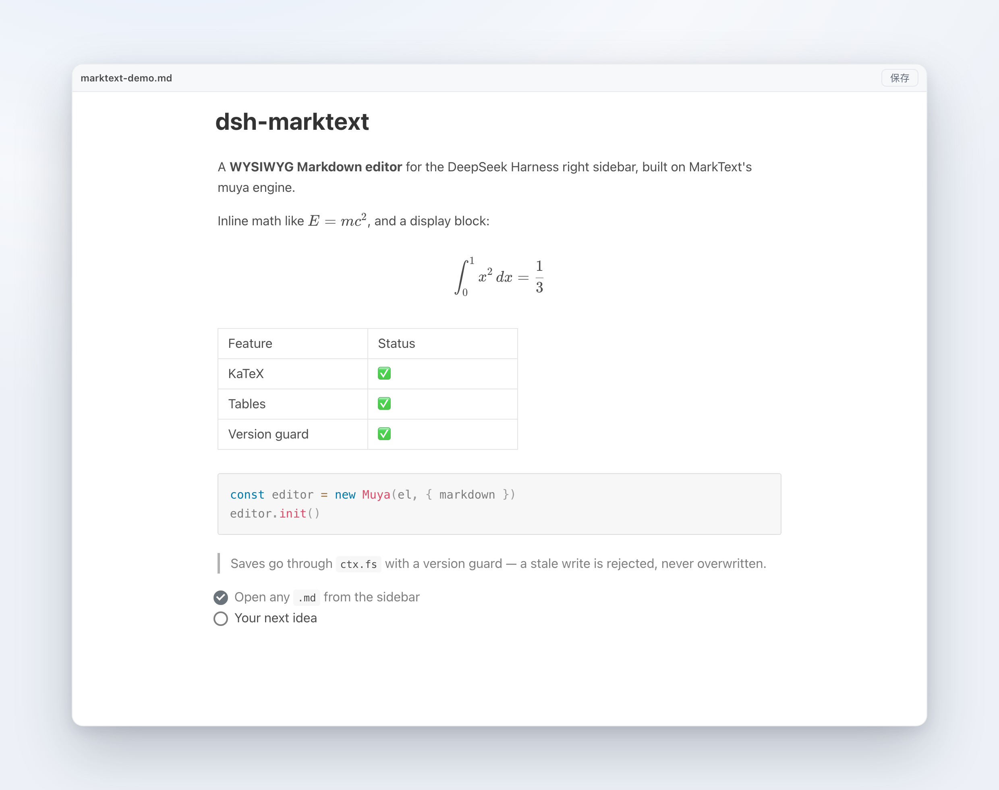
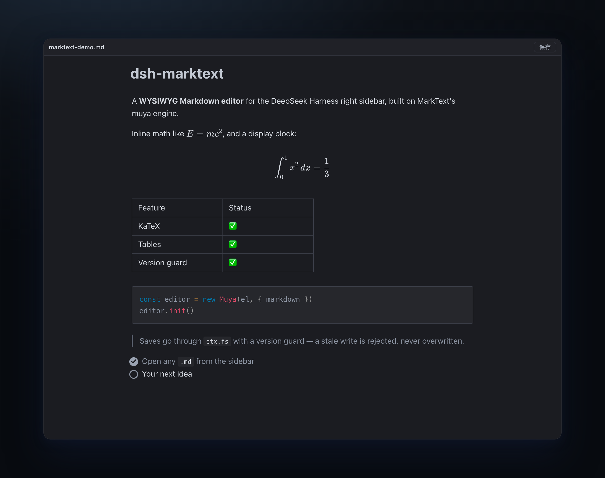

# dsh-marktext

[English](README.md) | [简体中文](README.zh.md)

[](https://www.npmjs.com/package/dsh-marktext)
[](https://github.com/Roland0511/dsh-marktext/actions/workflows/publish.yml)


<details>
<summary>Editor only — light and dark</summary>





</details>

**MarkText's editor core, running inside the DeepSeek Harness right sidebar.** Open a `.md` file and edit it as a rendered document — headings, tables, math, diagrams and images — then save straight back to disk with a version guard.

> MarkText is an Electron desktop app. This project does **not** ship its desktop shell: it uses the editor library MarkText extracts, [`@muyajs/core`](https://www.npmjs.com/package/@muyajs/core) (muya, MIT), and adds only the DSH integration around it.

## What you get

- Click any `*.md` / `*.markdown` / `*.mdown` / `*.mkd` in the sidebar file tree — it opens in a MarkText-style editing tab
- True WYSIWYG: markdown markers are hidden, blocks are real DOM (headings, lists, tables, quotes, code)
- KaTeX math, Mermaid, Vega, PlantUML and Prism highlighting ship offline and load on demand
- Toolbar with the file name, unsaved dot, status and a Save button; `⌘S` / `Ctrl+S` saves any time
- Undo and redo with `⌘Z` / `⇧⌘Z` (and `Ctrl+Z` / `Ctrl+Shift+Z`)
- Autosave 2.5 s after you stop typing
- Follows the host light/dark theme
- Relative images in the markdown (``) resolve against the document's own folder

## Install

### 1. From the DSH app (recommended)

Sidebar → **Plugins** → **Add plugin** → **Install a third-party plugin**, enter:

```
dsh-marktext
```

Then click **Enable now** and restart the app once. Open any `.md` file.

### 2. Command line (web profile)

```sh
dsh plugin --profile web add dsh-marktext
```

### 3. Manual (desktop profile)

The desktop app manages its `desktop` profile itself, so `dsh plugin --profile desktop` is rejected. Edit `~/.dsh/profiles/desktop/package.json` instead:

```jsonc
{
  "dsh": { "profile": { "bundles": [..., "dsh-marktext"] } },
  "dependencies": { ..., "dsh-marktext": "^0.1.1" }
}
```

```sh
cd ~/.dsh/profiles/desktop && pnpm install
```

Then restart the app.

### From GitHub instead of npm

Anywhere a package name is accepted you can use `github:Roland0511/dsh-marktext` (the built renderer is committed, so no build step is needed).

## Requirements

- DeepSeek Harness **0.2.1+** with `ctx.sidebarRightTabs`, `ctx.slots`, `ctx.fs` and `ctx.webServer`
- Node **20+** only if you build from source

## Architecture

```
DSH Web (React)
  lib/client.js  ── registers sidebar tab kind `marktext` (patterns: *.md)
      │             tab body = <iframe src="/dsh-marktext/renderer/<token>/index.html">
      │ postMessage (a single envelope: __dshmkt)
      ▼
renderer/ (standalone Vite build, contains muya)
      │ fetch
      ▼
lib/index.js (host plugin)
  · /dsh-marktext/renderer/<token>/*   static assets; misses fall back to the document folder (relative images)
  · /dsh-marktext/api/open|save|stat   through ctx.fs; save requires baseVersion
```

Why an iframe instead of rendering into React directly: muya declares its CSS variables on `:root` and appends its floating toolbars to `document.body`, so inlining it would leak styles into the host. The iframe isolates all of that; only the document, theme and save calls are bridged.

## Message protocol (v1)

Envelope: `{ __dshmkt: true, dir: 'down' | 'up', type, content }`

| Direction | type | content |
|---|---|---|
| down | `doc` | `{ path, displayPath, text, version, dark, locale }` |
| down | `saved` | `{ version }` |
| down | `save-error` | `{ code, message }` |
| down | `theme` | `{ dark }` |
| up | `ready` | — |
| up | `dirty` | `{ dirty }` |
| up | `save` | `{ text, baseVersion }` |
| up | `reload` | — |
| up | `open-external` | `{ href }` |

## Saving and the file policy

- Normal path: `ctx.fs.writeText(target, text, { kind: 'replaceIfVersion', version })`. A stale version returns `FS_STALE_VERSION`; the UI shows a conflict banner and never overwrites.
- If the host file policy refuses the write (`FS_SANDBOX_DENIED`, e.g. `workspace-write` / `read-only`), the save falls back to Node's native `fs.writeFile` — **the version guard is not relaxed**: the version is checked via `ctx.fs.stat` first, and re-read after the write.
- The fallback only applies to this one save action; the plugin gains no other write capability. Real OS errors (`EACCES` / `EPERM`) still surface as-is.
- A successful fallback returns `nativeFallback: true` in the `/save` response.

## Troubleshooting

If a `.md` opens but the tab says something like "no viewer available", the client half did not register its tab body. The client reports its registration result to the host; read it with:

```sh
curl -s http://127.0.0.1:<DSH-port>/dsh-marktext/api/diag | python3 -m json.tool
```

`typeRegistered`, `bodyRegistered` and `errors` tell you which step failed.

## Known limitations

- **Relative image paths only** — `/absolute/a.png` and `file://` URLs are not resolved yet.
- No "insert selection into chat", no file tree operations, no PDF export — these are next.
- Package size: ~4 MB tarball (~9.4 MB unpacked, 745 files); first paint ~1.6 MB (≈470 KB gzip), with Mermaid/Vega/Prism chunks loaded on demand.
- Overlaps with `dsh-markdown-typora`: both register `*.md` in the `extension` band, so only one of them wins; install one or the other.
- Built against muya `0.2.0` from npm; the repo's `HEAD` API is newer (different locale exports), so upgrades need a compatibility pass.

## Development

```sh
npm install
npm run build:renderer            # writes renderer/ (committed; only needed when src/renderer changes)
npm test                          # host routes, version guard, traversal, origin fence, client registration
node scripts/verify-renderer.mjs  # headless Chrome: open → render → save → disk
```

## Release

Publishing uses **npm Trusted Publishing (OIDC)** — no token or secret is stored in the repository. On every push to `main` the workflow runs tests, verifies the committed `renderer/` matches `src/renderer/`, and publishes only when the version in `package.json` is new. Provenance is attached automatically, and each new version also creates a **GitHub Release** (`v<version>`, auto-generated notes).

```sh
npm version patch --no-git-tag-version
git commit -am "chore: release x.y.z"
git push
```

## Star history

[](https://star-history.com/#Roland0511/dsh-marktext&Date)

## License

MIT — see [LICENSE](LICENSE). Third-party components and MarkText attribution: [NOTICE.md](NOTICE.md).
