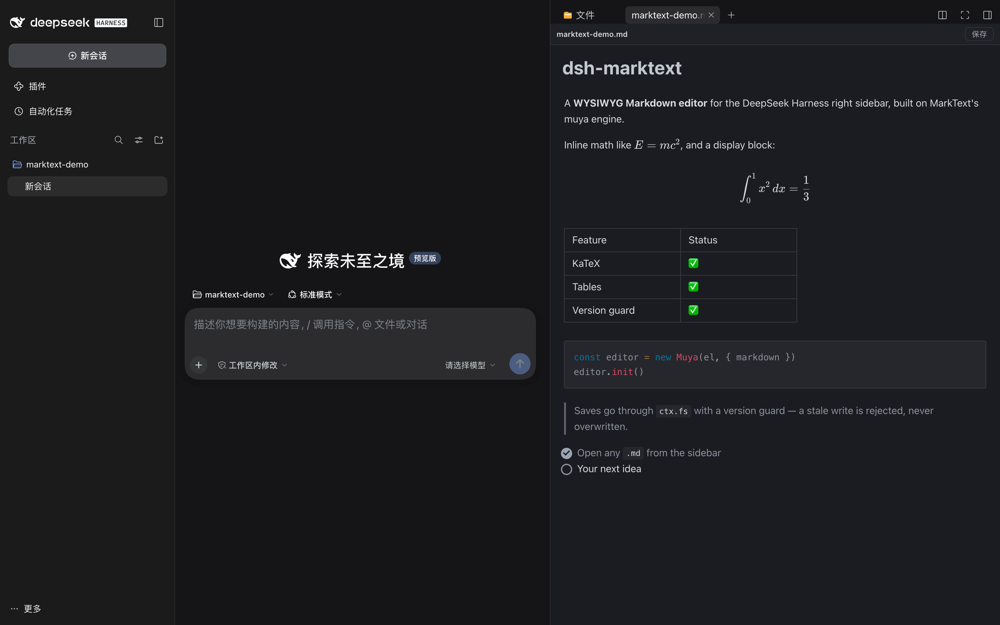

<p align="center">
  
</p>

<h1 align="center">dsh-marktext</h1>

<p align="center">
  <b>写 Markdown，所见即成品。</b><br/>
  把 MarkText 的编辑器内核搬进 DeepSeek Harness 右侧栏。
</p>

<p align="center">
  <a href="https://www.npmjs.com/package/dsh-marktext"></a>
  <a href="https://www.npmjs.com/package/dsh-marktext"></a>
  <a href="https://github.com/Roland0511/dsh-marktext/stargazers"></a>
  <a href="https://opensource.org/licenses/MIT"></a>
  
  <a href="https://github.com/Roland0511/dsh-marktext/actions/workflows/publish.yml"></a>
</p>

<p align="center">
  <a href="README.md">English</a> · <a href="README.zh.md"><b>简体中文</b></a>
</p>



**点开侧栏里的 `.md`，它就是排版好的成品**——标题、表格、公式、图表、图片，全都能就地编辑。没有左右分屏，没有「源码 ↔ 预览」来回切。`⌘S` 保存，文件经版本校验写回磁盘，不会盖掉别人的修改。

> MarkText 是 Electron 桌面应用，本插件**没有搬运它的桌面壳**，只用它拆出来的编辑器内核（[`@muyajs/core`](https://www.npmjs.com/package/@muyajs/core) / muya，MIT），外面套一层 DSH 集成。全部本地运行。

## 为什么它手感不一样

- **✍️ 你编辑的是文档，不是源码。** Markdown 标记全程隐藏，标题、列表、表格、引用都是真实元素——想改表格就点单元格，不用去数那一排竖线。
- **📊 公式和图表直接渲染。** KaTeX、Mermaid、Vega、PlantUML 随插件一起发，按需加载，**离线可用**，不依赖 CDN，也不用登录。
- **🖼️ 图片落在该在的位置。** `` 按文档所在目录解析，在别处写的文档搬进来照样显示正常。
- **💾 保存这件事很无聊，但这正是它该有的样子。** 停手 2.5 秒自动保存，`⌘S` 立即保存；磁盘上的文件被别人改过就弹冲突，绝不静默覆盖。
- **🌗 长得就像 DSH。** 明暗跟随宿主，不会突然变成另一套皮肤。
- **⌨️ 手指不用重新学。** `⌘Z` / `⇧⌘Z` 撤销重做、`⌘S` 保存、`⌘F` 查找。

## 一行装好

```sh
dsh plugin --profile web add dsh-marktext
```

**用桌面 app？** 打开 **Plugins → Add plugin → Install a third-party plugin**，输入 `dsh-marktext`，点 **Enable now**，重启一次 app。（桌面 profile 由 app 自己管理，上面那行命令是给 `dsh web` 用的。）

<details>
<summary>手动安装、从 GitHub 安装、环境要求</summary>

**手动（desktop profile）** —— 编辑 `~/.dsh/profiles/desktop/package.json`：

```jsonc
{
  "dsh": { "profile": { "bundles": [..., "dsh-marktext"] } },
  "dependencies": { ..., "dsh-marktext": "^0.1.11" }
}
```

```sh
cd ~/.dsh/profiles/desktop && pnpm install
```

然后重启 app。

**从 GitHub 装：** 任何接受包名的地方都能换成 `github:Roland0511/dsh-marktext`——构建产物已入库，不需要再构建。

**环境要求：** DeepSeek Harness **0.2.1+**（需要 `ctx.sidebarRightTabs`、`ctx.slots`、`ctx.fs`、`ctx.webServer`）。只有从源码构建时才需要 Node 20+。

</details>

## 它给你什么

| | |
|---|---|
| **打开任意 Markdown**<br/>侧栏里的 `*.md` / `*.markdown` / `*.mdown` / `*.mkd` 直接开成编辑标签页。 | **真正在编辑**<br/>表格、代码块、引用、任务列表都能直接操作，而不是改文本。 |
| **公式与图表**<br/>KaTeX 行内/块级、Mermaid、Vega-Lite、PlantUML、Prism 高亮。 | **带版本守卫的保存**<br/>乐观并发；冲突会提示，不会覆盖。 |
| **相对路径图片**<br/>按文档目录解析，每份文档一个令牌。 | **文件之间可跳转**<br/>`[下一篇](next.md)` 打开成新的 MarkText 标签页，而不是纯文本。 |
| **原生快捷键**<br/>`⌘S` · `⌘Z` · `⇧⌘Z`，自动保存，顶栏有未保存圆点。 | **跟着 DSH 走**<br/>明暗主题、语言、侧栏外观都和宿主一致。 |

## 实现方式

```
DSH Web（React）
  lib/client.js  ── 侧栏标签类型 `marktext`（patterns: *.md）
      │            标签体 = <iframe src="/dsh-marktext/renderer/<token>/index.html">
      │ postMessage（统一信封 __dshmkt）
      ▼
renderer/（独立 Vite 构建，内含 muya + mermaid）
      │ fetch
      ▼
lib/index.js（宿主插件）
  · /dsh-marktext/renderer/<token>/*   静态资源；miss 时回落到文档目录
  · /dsh-marktext/api/open|save|stat   走 ctx.fs；save 必须带 baseVersion
```

编辑器放在 iframe 里是刻意的：muya 的 CSS 变量定义在 `:root`、浮层直接挂到 `document.body`，内联会把样式泄漏到宿主。iframe 把这些一次性隔离，只让「文档、主题、保存」三件事跨界。

<details>
<summary>消息协议（v1）与文件策略回退</summary>

信封：`{ __dshmkt: true, dir: 'down' | 'up', type, content }`

| 方向 | type | content |
|---|---|---|
| down | `doc` | `{ path, displayPath, text, version, dark, locale }` |
| down | `saved` | `{ version }` |
| down | `save-error` | `{ code, message }` |
| down | `theme` | `{ dark }` |
| up | `ready` | — |
| up | `dirty` | `{ dirty }` |
| up | `save` | `{ text, baseVersion }` |
| up | `reload` | — |
| up | `open-external` | `{ href }` |

**保存与文件策略。** 正常路径是 `ctx.fs.writeText(target, text, { kind: 'replaceIfVersion', version })`，版本不符返回 `FS_STALE_VERSION`，界面弹冲突横幅。如果宿主文件策略拒绝写入（`FS_SANDBOX_DENIED`，例如 `workspace-write` / `read-only`），保存会回退到 Node 的 `fs.writeFile`，**但版本守卫不放松**：写前比对、写后重取版本。真正的 OS 权限错误（`EACCES` / `EPERM`）照原样报错。

</details>

## 排查

如果 `.md` 打开了但标签页提示类似「没有可用的查看方式」，说明客户端没注册上标签体。看注册回执：

```sh
curl -s http://127.0.0.1:<DSH端口>/dsh-marktext/api/diag | python3 -m json.tool
```

`typeRegistered`、`bodyRegistered` 和 `errors` 会指出是哪一步失败。

## 常见问题

**这是 MarkText 那个 app 吗？** 不是。这是它的编辑器内核（muya）包成的 DSH 插件——没有 Electron、没有桌面壳、不用再装第二个应用。

**会不会改我的排版？** 它保存的是编辑器序列化出的标准 CommonMark/GFM。真正保护你的是版本守卫：文件在底下被改过，会提示冲突而不是悄悄重写。

**能离线用吗？** 能。所有资源、字体、图表引擎、语法高亮都随插件一起发。

**会和别的 Markdown 插件打架吗？** 它和 `dsh-markdown-typora` 都在 `extension` band 抢 `*.md`，装一个就好。

**已知限制：** 绝对路径图片（`/abs/a.png`、`file://`）暂不支持；没有「选中片段插入对话」；没有导出 PDF。包体积约 4 MB，首屏约 1.6 MB。

## 开发

```sh
npm install
npm run build:renderer            # 产出 renderer/（已入库；只有改 src/renderer 时才需要）
npm test                          # 宿主路由、版本守卫、路径穿越、Origin 栅栏、客户端注册
node scripts/verify-renderer.mjs  # headless Chrome：打开 → 渲染 → 保存 → 落盘
```

## 发布

使用 **npm Trusted Publishing（OIDC）**，仓库里不存 token 或 secret。每次推送到 `main`：跑测试 → 校验 `renderer/` 与源码一致 → 版本是新的才发布 → 自动打 tag 建 **GitHub Release**（自动生成 release notes）。

```sh
npm version patch --no-git-tag-version
git commit -am "chore: release x.y.z"
git push
```

## Star 趋势

<a href="https://www.star-history.com/?type=date&repos=Roland0511%2Fdsh-marktext">
  <picture>
    <source media="(prefers-color-scheme: dark)" srcset="https://api.star-history.com/chart?repos=Roland0511/dsh-marktext&type=date&theme=dark&legend=top-left" />
    <source media="(prefers-color-scheme: light)" srcset="https://api.star-history.com/chart?repos=Roland0511/dsh-marktext&type=date&legend=top-left" />
    
  </picture>
</a>

## 许可

MIT —— 见 [LICENSE](LICENSE)。第三方组件与 MarkText 署名：[NOTICE.md](NOTICE.md)。
